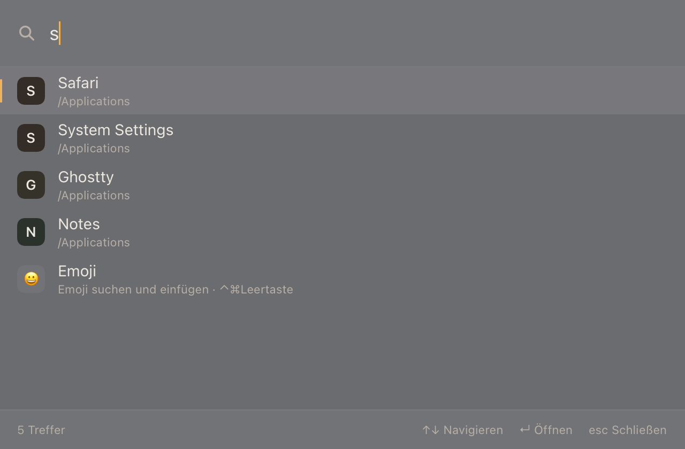
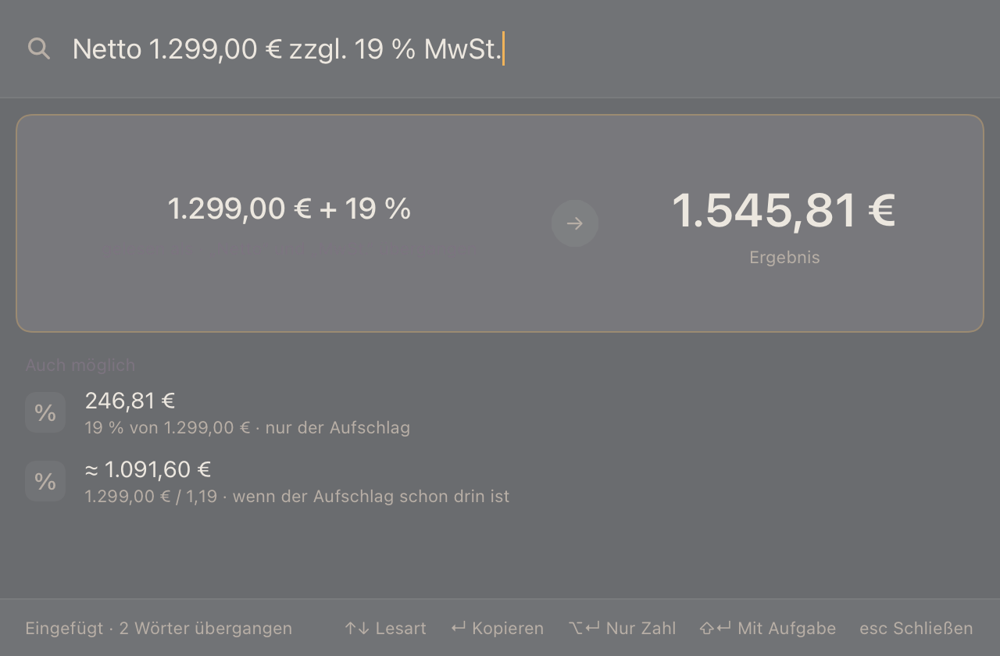
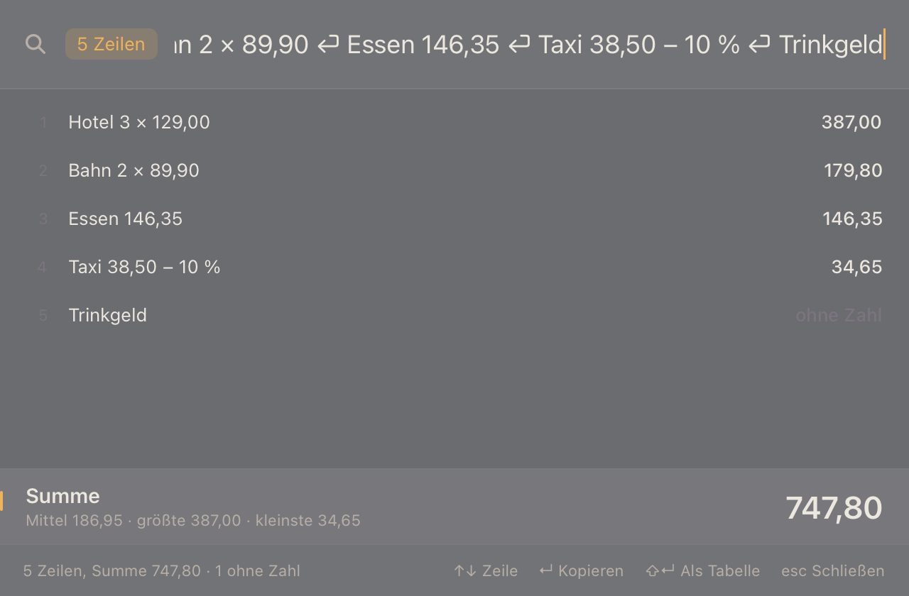
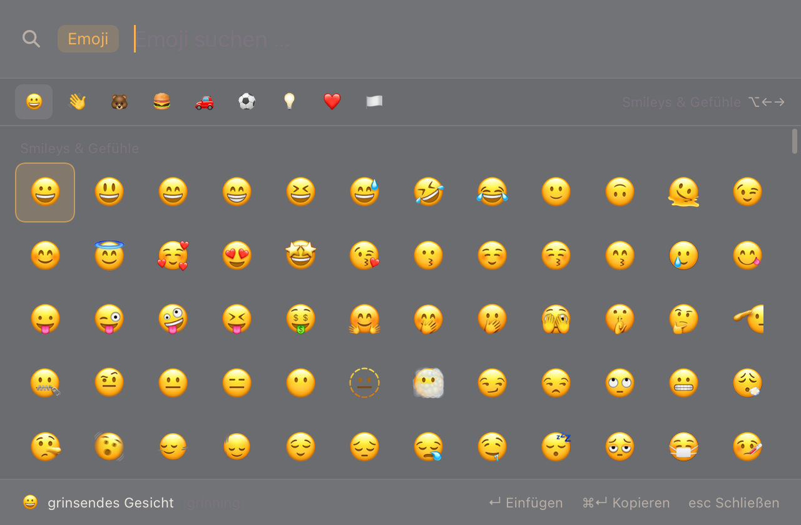

# Zugriff

A fast, native command palette for macOS. *Zugriff* is German for *access*.

Press the hot key, and the palette is on screen in about 12 ms, centred on the
display under the pointer. Type a few letters and press Return to open an app,
calculate a task or insert an emoji. The app you were working in keeps its
focus, and nothing leaves your Mac.

Zugriff is a single 3.5 MB binary written in Zig 0.17 on
[nanoui](https://github.com/justrach/nanoui). It runs as a background agent
without a Dock icon. Its interface is in German.

<table>
  <tr>
    <td></td>
    <td></td>
  </tr>
  <tr>
    <td></td>
    <td></td>
  </tr>
</table>

<sub>Rendered offscreen with `zig build shots`. On screen the panel is
translucent, with the desktop blurred behind it.</sub>

## At a glance

| | |
| --- | --- |
| Opening after the hot key | 11–12 ms (default), about 104 ms with `--unload-mode process` |
| Memory | 25 MB idle, 48–52 MB while open; 9–10 MB idle with `--unload-mode process` |
| Start | ready for the hot key about 130 ms after launch |
| Binary | 3.5 MB, nothing to install besides it |
| Network | none: no account, no telemetry |

Details and the measuring method are in [Performance](#performance).

## Features

### Launch apps

- Fuzzy search over the apps in `/Applications`, `~/Applications`,
  `/System/Applications` and the Finder, including apps in subfolders.
- Every word narrows the list: `chrome goog` finds Google Chrome. Parts of the
  bundle identifier match too, ranked below the name.
- `↵` opens the app, `⌘↵` shows it in the Finder.
- Real app icons, rendered once and cached as PNG files.
- The palette is there before the app list: the scan runs in the background,
  you can type at once, and the hits follow your query when the list arrives.

### Open files and addresses

- A path that starts with `/` or `~/` opens the file or folder.
- An `http://` or `https://` address opens in the default browser.

### Calculate

Type or paste a task. Zugriff reads German and English notation, the operator
signs that come out of Word, PDFs and web pages, and words such as `mal`,
`zzgl.` and `von` (`of`).

| Task | Result |
| --- | --- |
| `(1.299 + 89,90) × 3` | 4.166,70 |
| `1,299.50 * 2` | 2.599,00 |
| `80 + 19 %` | 95,2 (as on a pocket calculator) |
| `19 % von 80` | 15,2 |
| `Netto 1.299,00 € zzgl. 19 % MwSt.` | 1.545,81 €, and the other readings 246,81 € (the 19 % alone) and ≈ 1.091,60 € (19 % already included) |
| `2,4 GB in MB` | 2.400 MB, also in MiB and GiB |
| `100 km/h in m/s` | ≈ 27,78 m/s |
| `20 °C in °F` | 68 °F |
| `0,1 + 0,2` | 0,3 (exact) |
| `tan 45` | 1 (exact) |

- Units: length, area, volume, mass, time, speed, temperature, angle and data
  (decimal and binary). Convert with `in`.
- Functions and constants: `wurzel`/`sqrt`, `sin`, `cos`, `tan`, `ln`, `log`,
  `abs`, `runden`/`round`, `pi`, `e`.
- Exact fractions instead of binary floating point; a float only where a
  function or a constant has no exact value (`wurzel 2`, `pi`). Rounded results
  are marked with `≈`.
- Paste several lines, and Zugriff calculates each line and shows the sum,
  the mean, the largest and the smallest value.
- `=` alone lists the calculations of the current session.
- `↵` copies the result, `⌥↵` only the number with a decimal point, `⇧↵` the
  task with its result.
- There are no currency conversions, because Zugriff never goes online.

### Insert emoji

- All 1,906 emoji of Unicode 16, compiled into the binary.
- Search in German or English by name, keyword or shortcode: `daumen`,
  `thumbsup`, `herz`. Umlauts are optional.
- Open the picker with `⌃⌘Space`, with `:` at the start of a query, or through
  the *Emoji* row.
- `↵` inserts the emoji into the app in front, `⌘↵` copies it, `⌘1`–`⌘9`
  insert one of the recently used emoji. `⇥` opens the skin tones.
- With the mouse, a click inserts; a right-click or a long press opens the
  skin tones.
- Without a query the grid starts with the recently used emoji; in a search
  they win ties. The chosen skin tone is remembered.
- Inserting borrows the clipboard: Zugriff marks the emoji as transient, so
  clipboard managers skip it, and puts back what was there before.
- Inserting needs the Accessibility permission. Without it, or while a password
  field is active, `↵` copies the emoji instead.

### Help

- `?` lists everything the palette understands, each with an example. `↵` puts
  the example into the search field, so you see at once what it does.
- `help` and `hilfe` find the help row too.

### Stays out of the way

- A non-activating panel: the app in front stays active, and its text field
  gets the keyboard back when the palette closes.
- The palette closes with `esc`, with the hot key again, or when you click
  somewhere else.
- It appears on every Space and over full-screen apps.
- No Dock icon, no menu bar item.
- A lean start: Zugriff does not load WebKit, and it keeps AppKit from
  connecting the palette to Apple Intelligence (App Intents, Writing Tools).
  That leaves about 500 system libraries unloaded on macOS 27. Text input,
  accents and input methods work as usual.

### Control from the command line

- `zugriff show`, `hide`, `toggle`, `emoji`, `quit` and `status` control the
  running palette over a Unix socket. A second launch controls the running
  instance instead of starting a duplicate.
- `zugriff apps`, `emojis`, `calc` and `icons` work without the UI.

### Use less memory when idle

By default the palette stays loaded, so the hot key shows it within one or two
frames. `--unload-after <seconds>` frees memory after that much idle time, in
one of two ways (`--unload-mode`):

- `window` (default): the hidden window is closed and made again on the next
  hot key. The query, the last calculation and the emoji history stay.
- `process`: a small daemon keeps only the hot keys and the socket, and starts
  the palette as a separate process that ends itself after the idle time.
  Keys you type while that process starts are caught and handed over: text,
  and `↵`, `esc`, `⇥`, `↑` and `↓` in the order you pressed them. So you can
  press the hot key, type `saf` and Return before the palette is on screen,
  and Safari opens.

```sh
zugriff run --unload-after 60
zugriff run --unload-after 60 --unload-mode process
```

## Performance

Measured with Zugriff 0.2.2 (ReleaseSafe) on a MacBook Pro with M2 Max,
macOS 27.2.1 and the built-in display at 120 Hz, in November 2026. Every value
is the median of 10 to 12 runs.

**Opening:** the time from the show command (the hot key or `zugriff show`)
until the first frame with the text cursor reaches the window server. The
display shows it at its next refresh, at most one frame (8 ms) later.

| Mode | First opening | Later openings |
| --- | --- | --- |
| Default (stays loaded) | 12 ms | 11 ms |
| `--unload-mode window` | 12 ms | 23 ms after an unload |
| `--unload-mode process` | 104 ms (the palette process starts) | 104 ms after the idle time |

**Memory:** `phys_footprint` as reported by `footprint`, the value that
Activity Monitor shows as *Memory*.

| Mode | Idle, not opened yet | Open | Idle after use |
| --- | --- | --- | --- |
| Default | 25 MB | 48–52 MB | 43 MB |
| `--unload-mode window` | as default | 47–52 MB | 30 MB after an unload |
| `--unload-mode process` | 9 MB (daemon) | 10 MB daemon + 52 MB palette | 10 MB (daemon) |

Most of the memory of an open palette is the window's Metal surfaces, the
glyph atlas and AppKit itself. The `process` mode frees all of it and pays for
that with the start of a new process at the next hot key.

**Start:** the panel and the hot keys come first; the app scan, the icons and
the emoji preferences load in the background after that. The palette is ready
for the hot key 125–140 ms after launch.

The first start of a newly built or copied binary takes about 0.7 s longer
once: Metal compiles the shaders and caches them for later starts.

**Size:** 3.5 MB for the ReleaseSafe binary (arm64), including the emoji table
with German and English names.

## Install

Zugriff is developed and tested on macOS 27 on Apple Silicon. You need
Zig 0.17.1; [mise](https://mise.jdx.dev) installs it from `mise.toml`.

```sh
mise install
mise x -- zig build -Doptimize=ReleaseSafe
./zig-out/bin/zugriff
```

`zugriff` without arguments uses `⌘Space` for the palette and `⌃⌘Space` for
the emoji picker. `⌘Space` belongs to Spotlight by default: turn it off in
System Settings → Keyboard → Keyboard Shortcuts → Spotlight, or choose another
hot key:

```sh
./zig-out/bin/zugriff run --hotkey alt+space --emoji-hotkey none
```

If macOS refuses a hot key because another app has it, Zugriff writes that to
its log and runs without it.

### Start at login

Copy the binary to a fixed place:

```sh
install -d ~/.local/share/zugriff/bin
install -m 0755 zig-out/bin/zugriff ~/.local/share/zugriff/bin/zugriff
```

Save this as `~/Library/LaunchAgents/local.zugriff.plist`, with your user name
in the path:

```xml
<?xml version="1.0" encoding="UTF-8"?>
<!DOCTYPE plist PUBLIC "-//Apple//DTD PLIST 1.0//EN" "http://www.apple.com/DTDs/PropertyList-1.0.dtd">
<plist version="1.0">
<dict>
  <key>Label</key>
  <string>local.zugriff</string>
  <key>ProgramArguments</key>
  <array>
    <string>/Users/YOU/.local/share/zugriff/bin/zugriff</string>
    <string>run</string>
  </array>
  <key>RunAtLoad</key>
  <true/>
  <!-- Restart after a crash, stay stopped after `zugriff quit`. -->
  <key>KeepAlive</key>
  <dict>
    <key>SuccessfulExit</key>
    <false/>
  </dict>
  <key>StandardErrorPath</key>
  <string>/Users/YOU/Library/Logs/zugriff.log</string>
</dict>
</plist>
```

```sh
launchctl bootstrap gui/$(id -u) ~/Library/LaunchAgents/local.zugriff.plist
```

After an update, copy the new binary and restart the agent with
`launchctl kickstart -k gui/$(id -u)/local.zugriff`. `make install` does both
from a clean tree and signs the binary first; set `SIGN_IDENTITY`, `SIGN_ID`
and `LAUNCH_AGENT` for your own setup, because the defaults are the
maintainer's.

### Accessibility permission

Inserting emoji needs the permission in System Settings → Privacy & Security →
Accessibility. `zugriff status` shows whether the running palette has it.
macOS ties the permission to the code signature: a binary signed with your own
certificate keeps it across updates, a locally built binary without one needs
it again after every build.

## Command line

The output of the commands is in German.

```text
zugriff                        Start the palette (⌘Space, ⌃⌘Space)
zugriff run [--hotkey <spec>] [--emoji-hotkey <spec|none>]
            [--unload-after <s|never>] [--unload-mode window|process]
                               Start with your own hot keys, optionally unloading
zugriff show                   Show the running palette
zugriff hide                   Hide it
zugriff toggle                 Show or hide it
zugriff emoji                  Show the emoji picker
zugriff quit                   Quit the running palette
zugriff status                 Version and insert permission of the running palette
zugriff apps [query]           Search the installed apps (no UI)
zugriff emojis [query]         Search emoji as the palette does (no UI)
zugriff icons                  Render the app icons into the cache (no UI)
zugriff calc <task>            Calculate a task as the palette does (no UI)
zugriff --version              Version
```

Hot keys are written like `cmd+space`, `ctrl+cmd+space`, `alt+space`,
`ctrl+shift+space` or `cmd+k`.

## Files

| Path | Content |
| --- | --- |
| `~/Library/Application Support/zugriff/control.sock` | the control socket |
| `~/Library/Application Support/zugriff/emoji.txt` | skin tone and recently used emoji |
| `~/Library/Application Support/zugriff/help-seen` | marker: the help was opened once |
| `~/Library/Caches/tech.piparo.zugriff/icons` | app icons as PNG |

## Development

```sh
make hooks-install            # once per clone: the changeset pre-commit hook
make verify                   # changesets, build, zig fmt, tests (Debug, ReleaseSafe), ziglint
mise x -- zig build shots     # the palette's states as PNG in zig-out/shots, offscreen
```

The tests render the palette offscreen with nanoui's `ui.Tester`. They open no
window, register no hot key and touch neither the clipboard nor the icon cache.
The real agent takes the global hot keys and can post `⌘V` to other apps, so
try changes with their own `HOME` or on a separate test Mac.

The pictures in `docs/images` come from `zig build shots`.

The emoji table (`src/core/emoji_data.zig` with its texts in
`src/core/emoji_strings.txt`) is generated by `scripts/emoji_data.py` from
pinned Unicode, CLDR and gemoji sources; do not edit it by hand.

Every commit carries a changeset; the flow and releases are in
[CONTRIBUTING.md](CONTRIBUTING.md).

### Layout

```text
src/core/        Search, catalog, emoji table and calculator, without platform code
src/mac/         App discovery, icons, launching, hot keys, panel, inserting (AppKit/Carbon)
src/ui/          Palette, calculator, emoji and help views on nanoui, theme, emoji pictures
src/agent.zig    Resident agent: window and hot keys first, content in the background
src/daemon.zig   Daemon for --unload-mode process: hot keys and socket, starts the UI process
src/control.zig  Unix socket for show, hide, toggle, emoji, status and quit
src/main.zig     Command line
src/shots.zig    Offscreen pictures for `zig build shots`
```

## Background

Zugriff started as a Rust app on GPUI. This Zig version replaced it in
November 2026 and shares its files, so both read the same emoji history and
icon cache. `PRODUCT.md` and the FigCraft drafts in `design/figcraft` come
from the Rust version and describe what the palette should do (in German).
Where this version differs:

- Calculator: its own evaluator with exact fractions replaces fend-core. The
  Rust version's calculator tests pass unchanged; where fend was approximate,
  the result here is exact (`log 1000` is `3`, not `≈ 3`).
- Emoji pictures: nanoui draws text in one colour, so Core Text renders each
  visible emoji once into a colour picture (`src/ui/glyphs.zig`).
- Emoji with the mouse: right-click and long press open the skin tones.
- Size: 3.5 MB instead of about 12 MB.
- Apple Intelligence: `src/mac/intelligence.zig` replaces six private AppKit
  methods with empty ones before the start, and only when their signature is
  the expected one.

## License

Zugriff is licensed under the [MIT license](LICENSE). The licenses of the code
and data it includes are in [THIRD_PARTY_NOTICES.md](THIRD_PARTY_NOTICES.md)
and `licenses/`.
